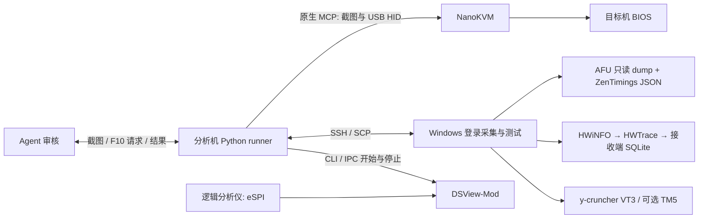

# NanoKVM Control

用原生 NanoKVM MCP、SSH 和确定脚本组织 DDR5 BIOS 调参实验：进入 BIOS、停在 F10 审核、回收开机证据、核对读回与遥测，然后执行压力测试。Agent 检查画面和例外；脚本负责固定键序、等待、传输与记录。没有 memtune-gateway。

当前实现针对 **Ryzen 9 9950X3D / Gigabyte B850M AORUS ELITE WIFI6E ICE / F12d / 4×32GiB DDR5**。BIOS 路径、32MiB dump 和请求解析均与该平台有关，不能直接用作通用主板配置。

## 框架



DSView 只采样、解码和保存，采样异常独立报告，不作为开机/测试门槛。开机时间为 F10 确认发送至首次恢复的有效 HDMI 图像，信号丢失/恢复及观测上下界保留，Windows 桌面就绪另计。

## Prerequisites

|位置|依赖|本项目需要的能力|
|---|---|---|
|分析机|Windows、PowerShell 7、Python 3.12+、Git、OpenSSH Client|`pwsh`、`ssh`、`scp` 可执行；Python 依赖见 `requirements.txt`|
|分析机|NanoKVM，HDMI 与 USB HID 接目标机|启用[原生 MCP](https://wiki.sipeed.com/hardware/en/kvm/NanoKVM_PCIe/mcp.html)，提供 `cube_screenshot`、`cube_press_keys`、`cube_type_text`，使用 Endpoint/API Key|
|分析机|DSLogic 等兼容逻辑分析仪、经核对的 eSPI 接线|与 DSView Stream 模式、50MHz 和实际总线电平兼容；频道名/接线须人工校准|
|分析机|[DSView-Mod（我的 DSView 项目）](https://github.com/POEG1726/DSView)|必须使用实现 `--capture-start/stop/status` CLI/IPC 的构建；任意旧 release 未必具备该接口|
|分析机 / 接收端|[HWTrace（我的遥测项目）](https://github.com/POEG1726/HWTrace)|配置接收端和 SQLite；runner 只读该库并检查新 collector 的真实 sample|
|目标机|Windows x64、PowerShell 7、Python 3.13、OpenSSH Server|SSH key 非交互登录；管理员权限、交互桌面和计划任务；无人值守需自行配置登录|
|目标机|[HWiNFO64](https://www.hwinfo.com/download/)|Sensors 模式和有效 `Global\HWiNFO_SENS_SM2`；复用已配置的 Windows 自启实例|
|目标机|HWTrace collector、filter、已有 `collector.json`|沿用 HWTrace 安装与认证配置；监控进程覆盖所选 y-cruncher 子进程/TM5|
|目标机|ZenTimings **定制 headless CLI**|`ZenTimings.Export.exe --export-json FILE --exit`，导出完整 JSON；普通 GUI 版不能替代|
|目标机|适用于该平台的既有 AMI AFU|仅 `/O` 导出唯一文件；不附带二进制，不使用刷写/恢复参数|
|目标机|[y-cruncher](https://www.numberworld.org/y-cruncher/)|当前配置沿用 0.8.7；VT3 默认 116GiB、10 次独立启动、每次最多 600s|
|分析机|F12d 精确 saved-request 离线解析器及其依赖|5mV 相邻点必须核对 dump 请求值；20mV 容差的 SMU 报告不足以区分|
|可选|TM5 / Agent checkpoint queue CLI|TM5 沿用已配置 profile；通知可关闭，开启须有支持该命令的本机 CLI 与明确会话 ID|

本仓库提供编排源码和配置示例，不分发上述软件、驱动、许可证、密钥或实验原始数据。部署与定制组件要求见 [setup](docs/setup.md)，DSView 接口见 [capture](docs/dsview.md)。

## 安装与配置

```powershell
py -3.13 -m venv .venv
.\.venv\Scripts\python.exe -m pip install -r requirements.txt
Copy-Item config/host.example.json config/host.json
Copy-Item config/dsview.example.json config/dsview.json
.\run.ps1 --help
.\.venv\Scripts\python.exe -m unittest discover -s tests -v
```

编辑本地配置中的设备地址、SSH 别名、程序路径、输出目录和接收端数据库路径，并按 [setup](docs/setup.md) 准备目标配置。示例默认关闭通知和 BIOS entry auto-apply。`run.ps1` 优先使用 `NANOKVM_PYTHON`，其次项目 `.venv`，最后 PATH 中的 Python，不依赖旧工作树。

NanoKVM Key 通过当前进程环境 `NANOKVM_API_KEY` 或本地 `connection_provider` 提供。SSH 使用现有 agent/身份配置；密码、私钥和 receiver SSH 命令不写入本仓库或 run 产物。`config/host.json`、`config/dsview.json`、`runs/` 和本地扫描队列已忽略。

## 运行流程

以下是**控制命令示例，会操作真实目标机**；先完成授权、BIOS 校准与[部署检查](docs/setup.md)。profile 的 slot 是候选数组下标，与 BIOS 的 Profile1–8 存档槽无关。下面使用 5mV profile 的 slot20，即 1.000V，不会自动执行整张扫描队列。

```powershell
.\run.ps1 init --run example1000 --profile profiles/b850m_f12d_vddp_5mv.json --slot 20
.\run.ps1 deploy --run example1000
.\run.ps1 arm --run example1000
.\run.ps1 enter --run example1000
# 看新图确认已校准的 Advanced / Tweaker 根页
.\run.ps1 anchor --run example1000 --image-sha256 <当前截图SHA256>
.\run.ps1 apply --run example1000
# 此时停在 F10；审核完整清单和 Profile8 保存证据，写 review_decision.json
.\run.ps1 review --run example1000 --decision runs/example1000/review_decision.json
.\run.ps1 save --run example1000
.\run.ps1 monitor --run example1000 --kind vt3 --background
```

`deploy` 上传脚本和验证后的 ZenTimings bundle，保留并更新已有目标配置，安装登录任务（不存在时）并写 pending run；本身不重启或开测。`enter` 发送 Delete 并观察画面，本身不发起重启。授权后可通过 `python -m nanokvm_flow.boot_entry --config config/host.json --run RUN --firmware-ui` 从 Windows 请求一次重启进入 BIOS，不自动重试。该入口在重启前请求 DSView 开始，按 `bios_entry_auto_apply` 可在确认真实根页后继续至 F10。详见 [workflow](docs/workflow.md)。

Windows 桌面确认后，外部 runner 停止并排空 DSView。目标采集检查 HWiNFO，单次导出 ZenTimings，执行 AFU `/O`，启动 HWTrace；分析机先接收/hash 校验 dump/JSON，核对精确请求和新遥测，再回传 manifest 绑定回执，才请求压力测试。十份日志和汇总接收并校验后通知 Agent。算法错误仍继续其余独立启动；短测无错误不等同长期稳定。

## 目录与脚本

|路径|用途|
|---|---|
|`run.ps1` / `nanokvm_flow/__main__.py`|CLI、初始化、截图、锚点、审核、部署和回收|
|`nanokvm_flow/boot_entry.py`|单次重启进入 BIOS、Delete 循环/固件 UI 入口、识别和例外|
|`nanokvm_flow/bios.py` / `workflow.py` / `state.py`|固定宏、SHA 绑定审核、持久化 run ledger|
|`nanokvm_flow/host.py` / `transfers.py`|SSH/SCP、读回、遥测、回执和测试产物校验|
|`nanokvm_flow/worker.py` / `hdmi_watch.py`|后台等待桌面/测试，独立 HDMI 观测|
|`nanokvm_flow/dsview.py` / `notify.py`|CLI/IPC adapter，去重与重试 outbox|
|`target/`|登录任务、采集、交互会话测试、结果解析；见 [target README](target/README.md)|
|`profiles/`|B850M F12d 校准与候选；历史粗扫保留，不代表当前授权范围|
|`scripts/read-image-text.ps1`|本机 WinRT OCR，需要 Windows OCR 语言组件|
|`tools/deploy_hwtrace_probes.py`|可选文件部署，只更新下次 collector 使用的 binary/filter，不停止当前负载|
|`tools/prepare_github.py`|白名单导出发布源码和 SHA256 清单，排除本地配置/实验/旧历史|
|`tests/`|离线 fake/mock 验证，不连接硬件|

## 操作边界与验证

- Delete 目标间隔 250ms，容忍 POST 暂态 HID 故障；没有 POST 总超时，黑屏不自动复位。
- 只有实际图像确认的校准根页才能运行宏；未知画面、Boot Failure、进入 Windows 等例外交给 Agent。
- F10 停在确认前，检查所有页面且变更恰好匹配；审核绑定请求/profile/图片 SHA，确认只消费一次。
- Profile8 普通覆盖保留现有 `agent-tune` 名称，并保存 Profile Saved 和槽名证据；首次命名/修复另行审核。
- 在 `runs/RUN/STOP` 写文件可停止本地后台循环，不会自动关测试或重启，已发出的动作无法撤回。

验证命令：`python -m unittest discover -s tests -v` 和 `python -m compileall -q nanokvm_flow target tools`。本次整理仅做离线检查；只读连通性、BIOS 校准、物理采集、完整实验分别需要证据。公开包不附带历史校准原图，也不向新设备授予执行许可。

BIOS 校准要点见 [calibration](docs/bios-calibration.md)，Agent 操作约定见 [agent workflow](docs/agent-workflow.md)。

本项目采用 [MIT License](LICENSE)；外部依赖见 [third-party notices](THIRD_PARTY_NOTICES.md)。GitHub 发布见 [publishing](docs/publishing.md)：从白名单导出目录建立独立初始提交，避免推送含旧研究资料的开发分支。
