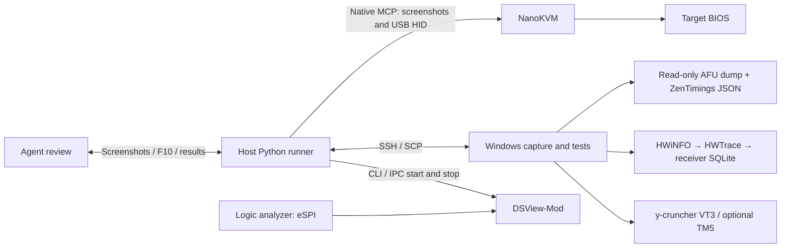

# NanoKVM Control

English (default) | [简体中文](README.zh-CN.md)

Scripted DDR5 tuning experiments using **native NanoKVM MCP and SSH**: enter
BIOS, pause for F10 review, collect boot evidence, verify saved requests and
telemetry, then launch stress tests. Deterministic scripts handle keys, waiting,
transfers and records; an agent reviews screenshots and handles exceptions.
There is no memtune-gateway.

The current implementation targets **Ryzen 9 9950X3D / Gigabyte B850M AORUS ELITE
WIFI6E ICE / F12d / 4×32GiB DDR5**. BIOS navigation, 32MiB dumps and request parsing
are platform-specific. Historical calibration is not authorization to operate a
new target.

## Architecture



DSView samples, decodes and saves only. Capture errors are reported separately;
they do not gate boot or determine test results. Boot timing runs from F10
confirmation send to the first restored valid HDMI image, retaining signal
loss/restoration observations and bounds. Windows desktop readiness is separate.

## Prerequisites

|Location|Dependency|Required capability|
|---|---|---|
|Host|Windows, PowerShell 7, Python 3.12+, Git, OpenSSH Client|`pwsh`, `ssh`, `scp`; Python packages from `requirements.txt`|
|Host / target connection|NanoKVM with target HDMI and USB HID|[Native MCP](https://wiki.sipeed.com/hardware/en/kvm/NanoKVM_PCIe/mcp.html): `cube_screenshot`, `cube_press_keys`, `cube_type_text`, Endpoint/API Key|
|Host|Compatible DSLogic/logic analyzer and calibrated eSPI wiring|Stream/Loop at 50MHz, suitable bus voltage and verified CS/CLK/IO mapping|
|Host|[DSView-Mod — our DSView project](https://github.com/POEG1726/DSView)|A build implementing `--capture-start/stop/status` CLI/IPC; older releases may lack it|
|Host / receiver|[HWTrace — our telemetry project](https://github.com/POEG1726/HWTrace)|Configured receiver and locally readable SQLite; actual samples from the new collector|
|Target|Windows x64, PowerShell 7, Python 3.13, OpenSSH Server|Noninteractive SSH key login, administrator privileges, interactive desktop and scheduled tasks; unattended login prepared separately|
|Target|[HWiNFO64](https://www.hwinfo.com/download/)|Sensors mode and valid `Global\HWiNFO_SENS_SM2`; reuse the existing Windows autostart instance|
|Target|HWTrace collector, filter and existing `collector.json`|Receiver authentication and a process list covering the actual y-cruncher worker/TM5|
|Target|[ZenTimings-Mod — our fork](https://github.com/POEG1726/ZenTimings-Mod)|[Headless release](https://github.com/POEG1726/ZenTimings-Mod/releases/latest): one-shot full JSON export; the ordinary GUI executable is not a substitute|
|Target|Existing platform-compatible AMI AFU|`/O` only, to a unique dump; no flashing or restore arguments|
|Target|[y-cruncher](https://www.numberworld.org/y-cruncher/)|Current profile uses 0.8.7, VT3, 116GiB, ten independent launches of at most 600s|
|Host|F12d exact saved-request parser and dependencies|Required for neighboring 5mV settings; an SMU reading with 20mV tolerance cannot identify them|
|Optional|TM5 / Codex CLI checkpoint notifications|Existing TM5 profile; a CLI supporting `codex queue` and an explicitly chosen chat UUID|

This repository provides orchestration source and example configuration. It does
not distribute third-party tools/drivers, keys or experiment data. See the
[deployment guide (Chinese)](docs/setup.md),
[DSView notes (Chinese)](docs/dsview.md) and
[ZenTimings-Mod integration](docs/zentimings-mod.md).

## Install and configure

```powershell
py -3.13 -m venv .venv
.\.venv\Scripts\python.exe -m pip install -r requirements.txt
Copy-Item config/host.example.json config/host.json
Copy-Item config/dsview.example.json config/dsview.json
.\run.ps1 --help
.\.venv\Scripts\python.exe -m unittest discover -s tests -v
```

Edit the local files for device address, SSH alias, tool/Python paths, output
folders and receiver database. Prepare `target/config.example.json` for the
intended target before first deployment. Notification delivery and BIOS-entry
auto-apply are disabled in the example. `run.ps1` uses `NANOKVM_PYTHON` if supplied,
otherwise the project `.venv`, then Python on PATH.

Provide the NanoKVM key through the process environment `NANOKVM_API_KEY`, or an
untracked `connection_provider` that returns `(url, key)`. SSH uses your existing
agent/identity configuration. Use verified host fingerprints and `BatchMode=yes`
key login; never put passwords, private keys or receiver SSH commands in source
or run artifacts. Local host/DSView config, run data and scan queues are ignored.

### ZenTimings-Mod bundle

Download and checksum the `windows-x64-headless.zip` from
[our release](https://github.com/POEG1726/ZenTimings-Mod/releases/latest).
Extract to `external/zentimings-headless` and keep the four runtime files plus
`build-manifest.json` at that directory's top level. Set `zentimings_cli_bundle`
in `config/host.json` accordingly. Deployment verifies and uploads the bundle to
a separate versioned target folder, leaving the GUI installation intact.
See [integration details](docs/zentimings-mod.md).

### Codex queue and your session ID

The background runner queues checkpoints into an **existing Codex chat** when
F10 review is required, a test finishes, or an exception needs attention. The
agent can finish its turn while scripts wait for hardware. A queued notification
is not proof it was read and never approves F10.

The place to enter your session ID is **`notifications.thread_id` in your local
`config/host.json`**. The example deliberately leaves it blank:

```json
{
  "notifications": {
    "enabled": false,
    "thread_id": "",
    "codex_executable": "codex",
    "retry_seconds": 30,
    "timeout_seconds": 20,
    "dry_run": false
  }
}
```

Replace the empty string with the reviewing chat's actual session/thread **UUID**,
then set `enabled` to `true`. Alternatively leave it empty and explicitly provide
`CODEX_THREAD_ID` in the runner's process environment; a nonempty config value
takes precedence. Use a chat UUID, not a PID, NanoKVM identifier, API key or title.

Check `codex queue --help` and your local CLI login before enabling notifications.
The adapter invokes `codex queue --thread UUID --message TEXT`, requires a UUID,
and does not select `--last`, create a chat or automatically resume one. Keep the
reviewing chat available. Full setup, dry-run and outbox behavior:
[English](docs/queue.md) / [中文](docs/queue.zh-CN.md).

## Run an experiment

These commands **operate real hardware**. Complete authorization, actual BIOS
calibration and deployment first. A profile's `slot` indexes its candidate array;
it is unrelated to the BIOS Profile1–8 save slots. This example selects slot20,
1.000V in the 5mV profile; it does not execute an entire scan queue.

```powershell
.\run.ps1 init --run example1000 --profile profiles/b850m_f12d_vddp_5mv.json --slot 20
.\run.ps1 deploy --run example1000
.\run.ps1 arm --run example1000
.\run.ps1 enter --run example1000
# Inspect the new image: it must be the calibrated Advanced / Tweaker root.
.\run.ps1 anchor --run example1000 --image-sha256 <CURRENT_IMAGE_SHA256>
.\run.ps1 apply --run example1000
# Pause at F10. Review every change and Profile8 evidence; write a bound decision.
.\run.ps1 review --run example1000 --decision runs/example1000/review_decision.json
.\run.ps1 save --run example1000
.\run.ps1 monitor --run example1000 --kind vt3 --background
```

`deploy` uploads scripts and the verified ZenTimings bundle, preserves/updates
existing target configuration, installs a missing logon task and writes the
pending run. It does not reboot or start a test. `enter` sends Delete and observes
video; it does not initiate a reboot. With explicit authorization, use
`python -m nanokvm_flow.boot_entry --config config/host.json --run RUN --firmware-ui`
to request one Windows firmware-UI reboot, with no retry. This entry requests
DSView start before reboot; configured auto-apply continues only from the actual
calibrated root and still pauses at F10.

After this run's interactive desktop is confirmed, the external runner stops
and drains DSView. Target capture checks HWiNFO, exports one ZenTimings JSON,
runs AFU `/O` and starts HWTrace. The host receives/hash-verifies the originals,
checks exact requests and fresh receiver samples, then uploads a manifest-bound
receipt before requesting tests. Ten logs and summaries must be received and
verified before completion notification. Algorithm errors do not silently end
the remaining independent launches. A short error-free run does not prove
long-term stability.

## Source map

|Path|Role|
|---|---|
|`run.ps1` / `nanokvm_flow/__main__.py`|CLI, run creation, screenshots, anchors, review, deployment and collection|
|`nanokvm_flow/boot_entry.py`|One reboot into BIOS, Delete/firmware-UI entry, classification and exceptions|
|`bios.py` / `workflow.py` / `state.py` in `nanokvm_flow/`|Fixed macros, hash-bound review and durable run ledger|
|`host.py` / `transfers.py` in `nanokvm_flow/`|SSH/SCP, readback, telemetry, receipts and artifact verification|
|`worker.py` / `hdmi_watch.py` in `nanokvm_flow/`|Background progress and independent HDMI observations|
|`dsview.py` / `notify.py` in `nanokvm_flow/`|Capture CLI/IPC and deduplicated notification outbox|
|`target/`|Logon capture, interactive-session tests and result parsing|
|`profiles/`|B850M F12d calibration and candidates; historical values do not extend current authorization|
|`scripts/read-image-text.ps1`|Host WinRT OCR; Windows OCR language components required|
|`tools/deploy_hwtrace_probes.py`|Optional file-only update for the next collector start; preserves active workloads|
|`tools/prepare_github.py`|Allowlisted public snapshot and checksums without private runtime data/history|
|`tests/`|Offline fake/mock verification; no hardware connection|

## Operating boundaries and verification

- Delete targets a 250ms interval and tolerates transient POST HID failures.
  There is no total POST timeout or automatic reset on black video.
- Macros require an actual calibrated root image. Unknown screens, Boot Failure
  and missed BIOS entry pause for agent inspection.
- F10 pauses before confirmation. Every page must match exactly; request, profile
  and image hashes bind the decision, which is consumed once.
- Routine Profile8 overwrite preserves its existing `agent-tune` name and retains
  Profile Saved/slot-name evidence. Initialization or name repair is separate.
- A `runs/RUN/STOP` file stops supporting local loops; it does not terminate target
  tests, reboot or undo keys already sent.

Offline checks: `python -m unittest discover -s tests -v` and
`python -m compileall -q nanokvm_flow target tools`. Connectivity, live calibration,
physical capture and end-to-end experiments require their own evidence. The
published source does not include the original calibration screenshots.

Additional guides, currently in Chinese: [workflow](docs/workflow.md),
[BIOS calibration](docs/bios-calibration.md), [target pipeline](target/README.md),
[agent rules](docs/agent-workflow.md) and [publication](docs/publishing.md).

[MIT License](LICENSE). External components retain their own licenses; see
[third-party notices](THIRD_PARTY_NOTICES.md).
